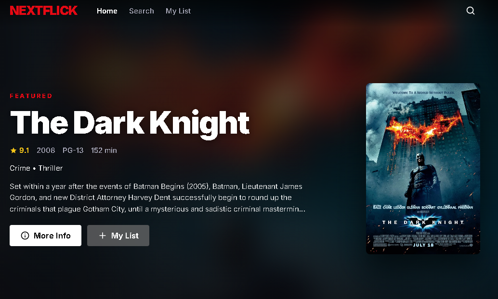
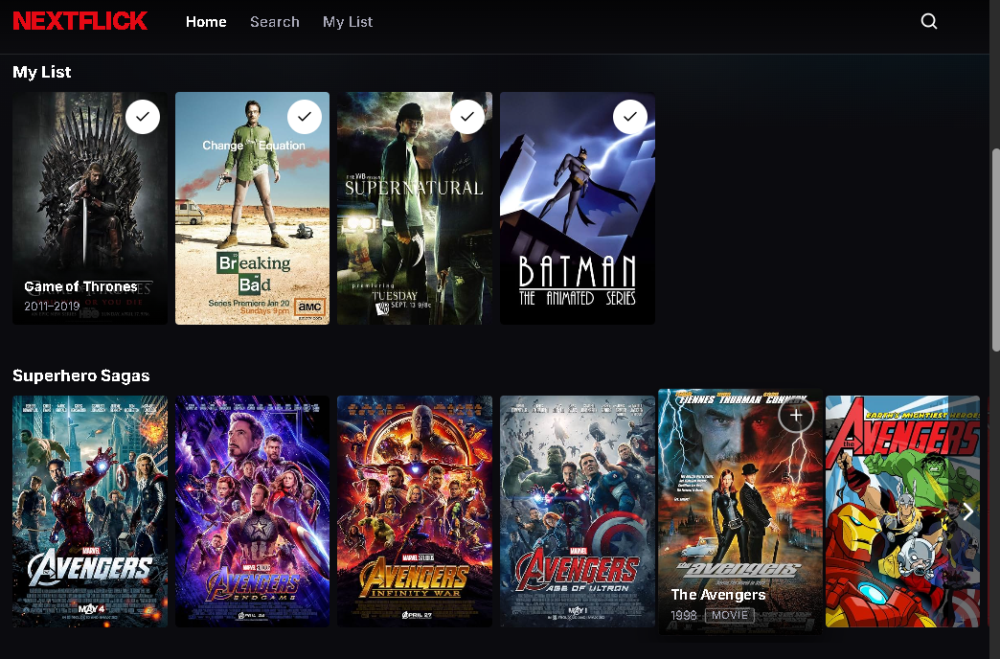
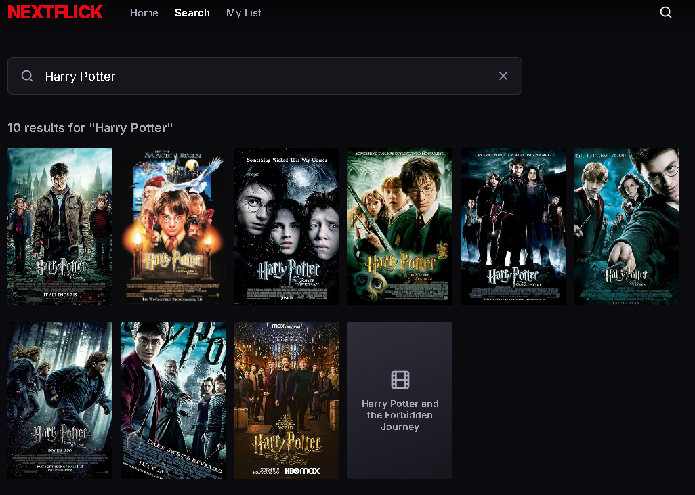
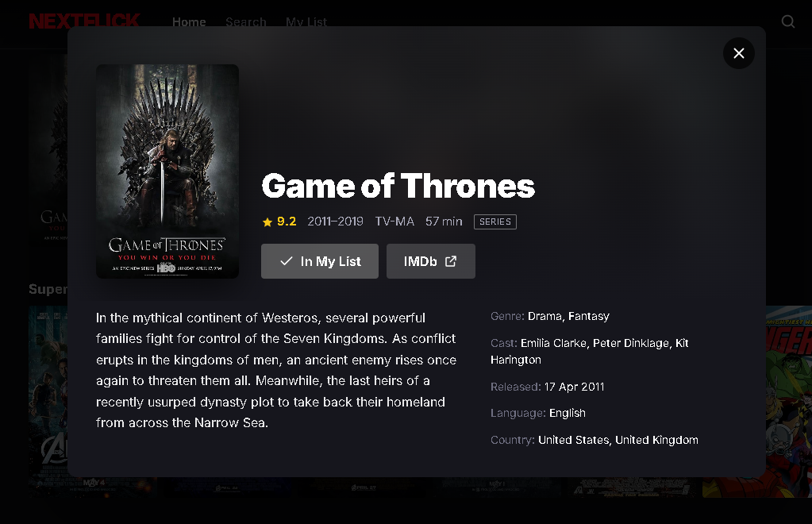
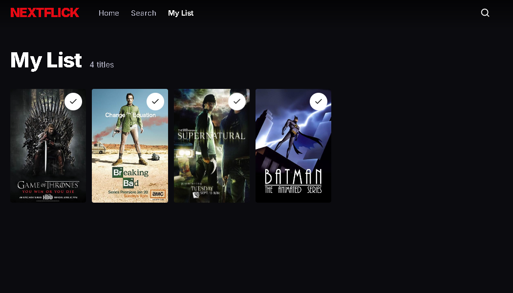

## Live Demo

**Access the project:** https://nextflick-three.vercel.app

## Recommendations

NextFlick recommends movies and series with a neural network trained with **TensorFlow.js** on the users' favorites, inside the API. Add 3 titles to My List (or click **Recommend movies & series**) and the "Recommended for you" row appears below My List. How it works, the endpoints and how the model was evaluated are in the [Backend README](./backend/README.md#recommendations-recommendations).

## Documentation

Detailed documentation for each part of the project is located in their respective directories:

- **[Backend README](./backend/README.md)** - NestJS API: technologies and libraries, setup and environment variables, endpoints, Redis cache, MongoDB and the TensorFlow.js recommendation model

- **[Frontend README](./frontend/README.md)** - Next.js app: technologies and libraries, setup, project structure and features

## Screenshots

**Home: featured title**

**Home: My List and catalog rows**

**Search**

**Movie details**

**My List**

## Hosting

The project is deployed in the cloud, with each part on its own platform:

| Part | Platform | URL |
|---|---|---|
| Frontend (Next.js) | [Vercel](https://vercel.com) | https://nextflick-three.vercel.app |
| Backend API (NestJS) | [Render](https://render.com) | https://nextflick-o00k.onrender.com |
| API docs (Swagger) | Render | https://nextflick-o00k.onrender.com/api |

Supporting services: **MongoDB Atlas** (database), **Upstash Redis** (cache) and **OMDb API** (movie data).

## Quick Start

1. Clone the repository
2. Access the specific documentation for each part:
   - For backend: `cd backend && cat README.md`
   - For frontend: `cd frontend && cat README.md`
3. Follow the installation and execution instructions in each README