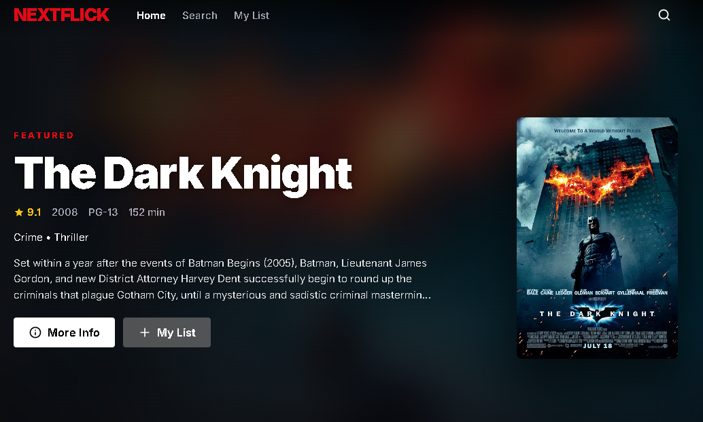
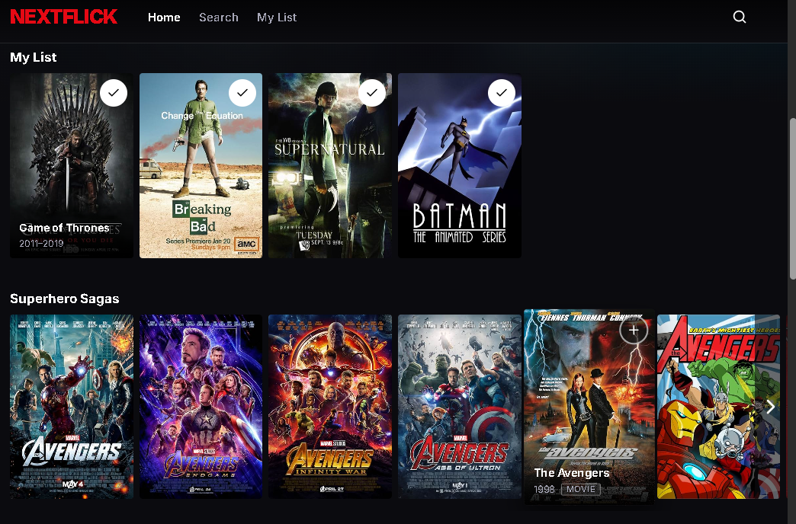
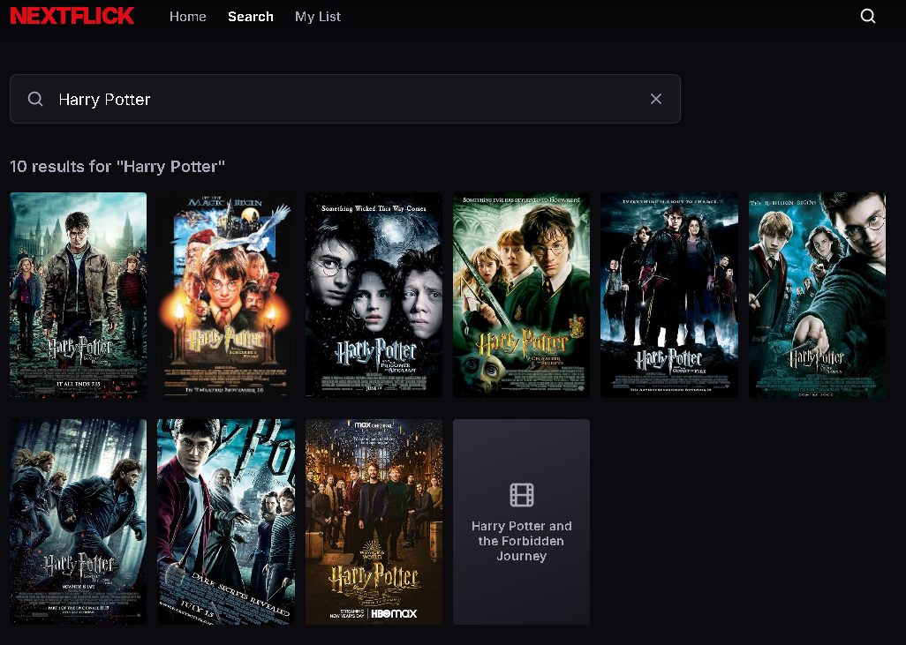
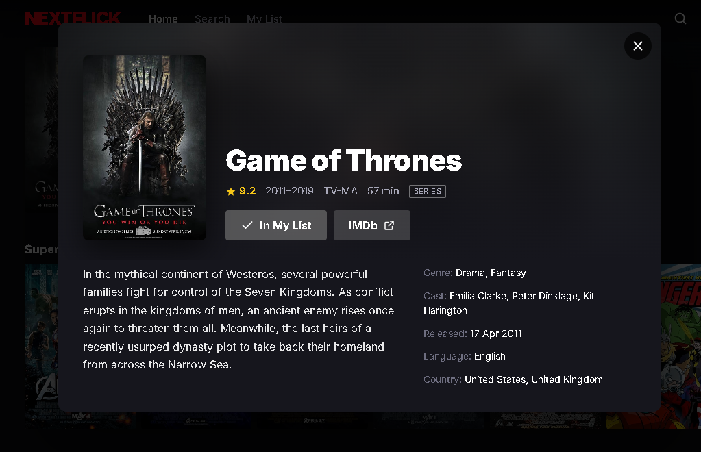
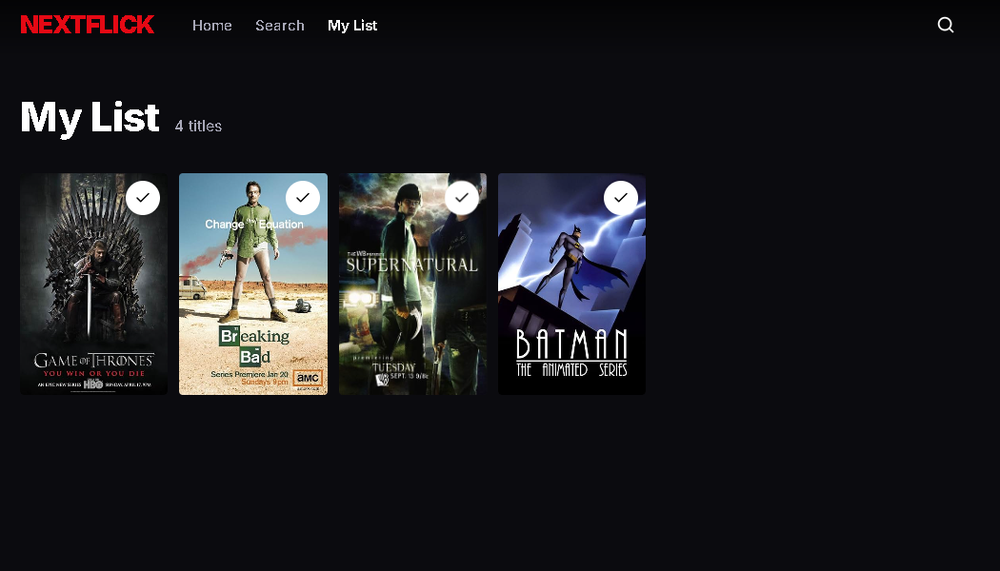

## Live Demo

**Access the project:** https://nextflick-three.vercel.app

## Recommendations

NextFlick recommends movies and series with a neural network trained with **TensorFlow.js** on the users' favorites, inside the API. Add 3 titles to My List (or click **Recommend movies & series**) and the "Recommended for you" row appears below My List. How it works, the endpoints and how the model was evaluated are in the [Backend README](./backend/README.md#recommendations-recommendations).

## Documentation

Detailed documentation for each part of the project is located in their respective directories:

- **[Backend README](./backend/README.md)** - NestJS API: technologies and libraries, setup and environment variables, endpoints, Redis cache, MongoDB and the TensorFlow.js recommendation model

- **[Frontend README](./frontend/README.md)** - Next.js app: technologies and libraries, setup, project structure and features

- **[End-to-end tests](#end-to-end-tests-playwright)** - Playwright tests for the deployed app, plus the [prompts](#prompts) used to scaffold and generate them

## Screenshots

**Home: featured title**



**Home: My List and catalog rows**



**Search**



**Movie details**



**My List**



## Hosting

The project is deployed in the cloud, with each part on its own platform:

| Part | Platform | URL |
|---|---|---|
| Frontend (Next.js) | [Vercel](https://vercel.com) | https://nextflick-three.vercel.app |
| Backend API (NestJS) | [Render](https://render.com) | https://nextflick-o00k.onrender.com |
| API docs (Swagger) | Render | https://nextflick-o00k.onrender.com/api |

Supporting services: **MongoDB Atlas** (database), **Upstash Redis** (cache) and **OMDb API** (movie data).

## End-to-end tests (Playwright)

The deployed frontend (https://nextflick-three.vercel.app) is tested with [Playwright](https://playwright.dev) (`@playwright/test`, Chromium only). The setup lives at the repository root, separate from `frontend/` and `backend/`:

```
package.json            # only dev dependency: @playwright/test
playwright.config.ts    # baseURL = Vercel deploy, 5s default timeout, chromium project
tests/
  home.spec.ts          # app shell: page title, main navigation, going to /search
  search.spec.ts        # search with results ("matrix") and with no results
  favorites.spec.ts     # add a title to My List from search, see it on /favorites, remove it
  new-user.spec.ts      # "New user" dialog validation (name and username rules), cancel / Escape
.github/workflows/playwright.yml
```

### Running

```bash
npm ci
npx playwright install --with-deps chromium   # on Windows/macOS: npx playwright install chromium
npm test                                      # headless run
npm run test:headed                           # watch the browser
npm run test:report                           # open the last HTML report
```

### Things to know

- **Backend cold start:** the API runs on Render's free tier and can take ~50s to wake up ("Waking up the server…"). The global timeout stays at 5s for what Vercel serves (page title, navigation); tests that wait for API data raise their own limit with `test.setTimeout(...)` and longer per-assertion timeouts.
- **Shared production data:** the tests run against the live deploy and its database. A new browser uses the first user (Guest), so `favorites.spec.ts` removes its title before and after running, keeping Guest's list unchanged. The "New user" test never submits the form, so no users are created.
- **Locators:** tests use roles and accessible names the app already exposes (`navigation "Main"`, `searchbox "Search movies"`, `More info about <Title> (<Year>)`, `Add/Remove <Title> to/from My List`).

### CI

[`.github/workflows/playwright.yml`](./.github/workflows/playwright.yml) runs on pushes and pull requests to `main`: checkout, Node.js from `.nvmrc`, `npm ci`, install Chromium, `npm test`. On failure it uploads the HTML report as the `playwright-report` artifact (kept for 7 days).

## Prompts

The [`prompts/`](./prompts) folder holds the prompts used to build the Playwright tests with an AI agent and the [Playwright MCP](https://github.com/microsoft/playwright-mcp) server (configured in `.mcp.json`):

| File | Purpose |
|---|---|
| [`project-scaffolding.md`](./prompts/project-scaffolding.md) | Sets up Playwright from scratch: dependency, config (baseURL, timeouts), first spec and the GitHub Actions workflow |
| [`generate_test.prompt.md`](./prompts/generate_test.prompt.md) | Rules for the test generator: run each step in the browser through the MCP first, only then write the test, run it until it passes, prefer `getByRole` and keep tests idempotent |
| [`generate-tests.md`](./prompts/generate-tests.md) | The scenarios to generate: search, search with no results, My List add/remove and the "New user" dialog validation |

`.mcp.json` reads the browser extension token from the `PLAYWRIGHT_MCP_EXTENSION_TOKEN` environment variable. Copy `.env.example` to `.env` and paste your token from the Playwright MCP extension. Claude Code does not load `.env` files on its own, so the variable must be set before the editor starts, for example on Windows:

```powershell
setx PLAYWRIGHT_MCP_EXTENSION_TOKEN "<your token>"   # then restart VS Code / Claude Code
```

To regenerate or extend the tests, give the agent `generate_test.prompt.md` as instructions and `generate-tests.md` (or new scenarios in the same style) as the task.

## Quick Start

1. Clone the repository
2. Access the specific documentation for each part:
   - For backend: `cd backend && cat README.md`
   - For frontend: `cd frontend && cat README.md`
3. Follow the installation and execution instructions in each README